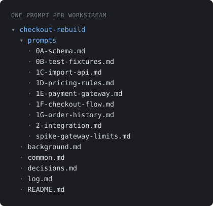
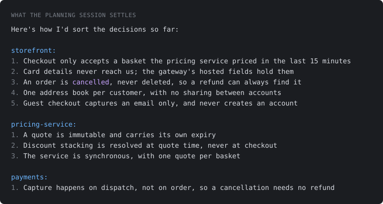

# claude-skills

Two skills for Claude Code, for work that is too big for one agent session.

## Installing

```
/plugin marketplace add AaronMachin/claude-skills
```

then, as a separate command:

```
/plugin install workstream-planning@claude-skills
```

Then start a new session. To take a single skill without the plugin, copy its folder from
`workstream-planning/skills/` into `~/.claude/skills/` instead.

Both need the [superpowers](https://github.com/obra/superpowers) plugin, from the official
marketplace. `planning-workstreams` uses `superpowers:brainstorming`, and the prompts it
writes point their own agents at `superpowers:writing-plans`,
`superpowers:using-git-worktrees` and the build-and-verify skills.

## planning-workstreams



Splits a large piece of work into workstreams and writes the prompt that starts each one, so
several agents can run them at the same time or one after another.

It produces a shared folder holding a diagram of the system, a dependency grid, a phase table
with separate orders for specifying and building, what the plan assumes and what the planner
decided on your behalf, an append-only log every agent writes to, and one prompt per workstream.

Each prompt hands its agent a piece of the problem to work out rather than a list of tasks, so
the agent runs its own brainstorm, spec and plan for its slice.



## run-workstream

Reads a plan and says where every workstream stands: what has been specced, built, reviewed or
merged, what is blocked and on which check, and what can start right now. It works that out from
the log, the branches, the pull requests and the readiness checks each prompt carries, then hands
you the command to start the one you pick. It reads and reports, and changes nothing. It also says what that
workstream may change, what it may do outside the working tree, and how it knows it has
finished.

## decision-records

Records a technical decision about a codebase as two files: a short frozen statement that
everything cites, and an optional details file holding the working behind it. Accepted records
are never edited, so changing a decision means a new record that supersedes the old one, which
is what keeps the reasoning as it was rather than as someone later wished it had been.

It is deliberately not your organisation's architecture decision process. If reversing a
decision would take another team, a customer or a contract, it belongs in whichever process
covers that, and this skill says so rather than recording it.
