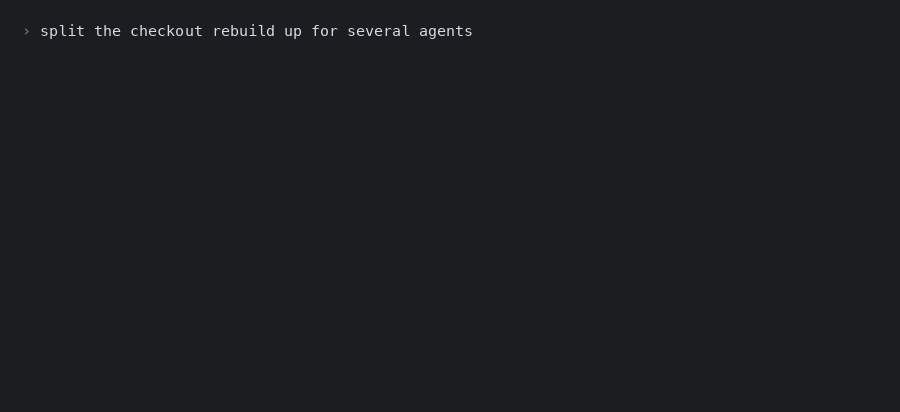
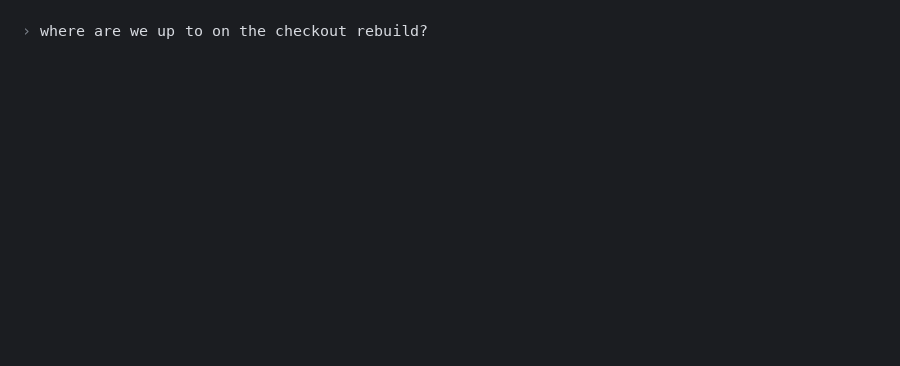

<p align="center">
  
</p>

<p align="center">
  Three Claude Code skills for work that is too big for one session.
</p>

---

Some work does not fit in one agent run. Split it into workstreams, give each its own agent and
its own self-contained prompt, and the hard parts become: where to cut it, how to stop the agents
contradicting each other, and knowing what to start next. That is what these do.

## Install

```
/plugin marketplace add AaronMachin/claude-skills
```

then, as a separate command:

```
/plugin install workstream-planning@claude-skills
```

Needs [superpowers](https://github.com/obra/superpowers), from the official marketplace.

## planning-workstreams

Asks what it needs to know, then cuts the work up and writes a prompt per workstream — each one
standing on its own, with what it may change, what it must not touch, and how it knows it is done.



## run-workstream

Tells you where everything stands and what can start now. It runs the readiness checks each prompt
already carries, so "nobody has started this" and "nobody can yet" stop looking the same.



## decision-records

Keeps decisions as files in the repo. Accepted ones are frozen, so changing your mind writes a new
record that supersedes the old one, and the reasoning stays as it was rather than as you later
wished it had been.

<sub>Demos are staged, not recordings.</sub>
